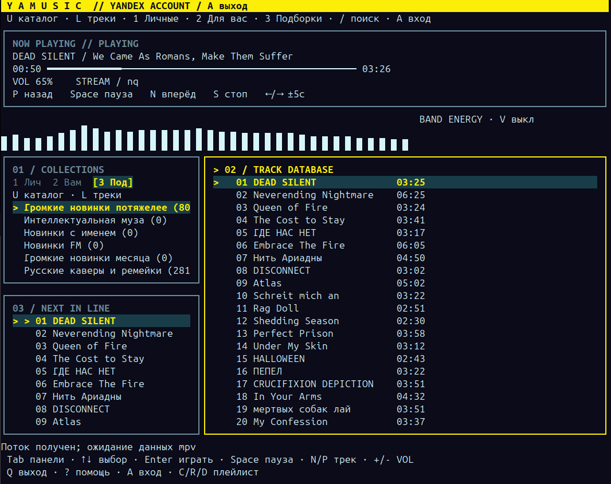
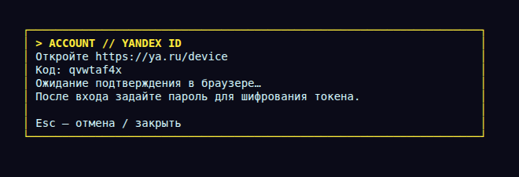
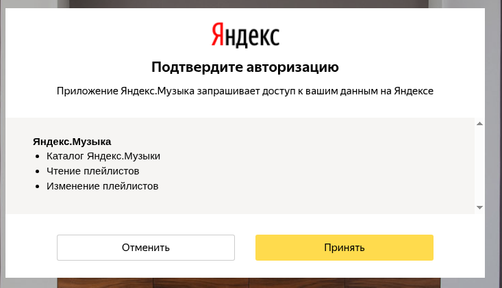

# tui.yamusic

TUI-клиент Яндекс.Музыки на Go: каталог, поиск, плейлисты, OAuth Device Flow и
воспроизведение через `mpv` с управлением по JSON IPC.

> [!WARNING]
> Это **неофициальный клиент**, не связанный с Яндексом. Интеграция реализована
> на основе официальной документации Яндекса, но это не означает, что Яндекс
> поддерживает этот клиент или гарантирует совместимость. API и правила доступа
> могут измениться. Используйте только свой аккаунт и свою
> подписку, не обходите оплату, региональные ограничения и рекламные вставки,
> не распространяйте полученные аудиофайлы. Условия использования
> Яндекс.Музыки и законодательство об авторском праве остаются в силе.

## Интерфейс



## Что умеет

- Живой каталог из трёх разделов: **Личные**, **Для вас**, **Подборки**.
- Гостевая работа с публичными подборками; личные разделы требуют входа.
- Полная загрузка треков выбранного плейлиста, а не только preview из каталога.
- Поиск треков с постраничной навигацией.
- Воспроизведение через внешний `mpv`: пауза, stop, next/prev, seek, громкость,
  mute и автоматический переход к следующему треку.
- OAuth Device Flow Яндекс ID; refresh токена и повторный вход.
- Шифрованное хранение токена: AES-256-GCM, PBKDF2-SHA256 (600 000 итераций),
  случайные salt и nonce. Пароль не сохраняется.
- Управление собственными плейлистами: создание, переименование, удаление,
  добавление и удаление треков; лайки треков.
- Индикатор реальной энергии частотных полос по данным `mpv`/lavfi.
- Полностью офлайновый демо-режим.
- Опциональный JSONL-лог на запуск в `logs/`, без токенов и URL потоков.

## Требования

- Linux (используется Unix-сокет `mpv`).
- Go **1.26+**.
- `mpv` в `PATH` или путь, переданный через `-mpv`.
- Терминал не меньше **60×20**; при меньшем размере выводится предупреждение.
- Право записи в текущий каталог для данных живого режима (`.local/`) и логов (`logs/`), если они включены.
- Аккаунт Яндекс.Музыки для личных разделов, полных треков и изменений
  плейлистов. Доступ к части треков зависит от подписки и региона.

## Быстрый старт

```bash
git clone <repo-url> tui.yamusic
cd tui.yamusic

go run .
# или
make build
./yamusic
```

Если `mpv` не в `PATH`:

```bash
go run . -mpv /path/to/mpv
```

### Режимы запуска

```bash
go run .                       # живой режим: сеть, аккаунт, mpv
go run . -demo                 # офлайн-демо: вымышленные треки, без сети и звука
go run . -preview              # напечатать один статический кадр и выйти
```

Флаг `-preview` принимает `-width` и `-height`.

## Настройка доступа

Для входа и воспроизведения скопируйте `.env.example` в `.env` и заполните
поля разрешёнными для вашего использования значениями:

```bash
cp .env.example .env
chmod 600 .env
```

- `YAMUSIC_CLIENT_ID` и `YAMUSIC_CLIENT_SECRET` — реквизиты OAuth-приложения.
- `YAMUSIC_STREAM_KEY` — ключ подписи запросов воспроизведения.

Файл `.env` читается из текущего каталога в формате `ИМЯ=значение` без кавычек.
Переменные процесса имеют приоритет. Реальные значения не входят в репозиторий.
Без настройки доступны демо, preview, гостевые подборки и поиск.

## Вход в аккаунт

1. Нажмите `A`.
2. Откройте <https://ya.ru/device> и введите код, показанный в TUI.
3. После подтверждения задайте пароль для локального файла токена.





Запрашиваются только права `music:content music:read music:write`. Токен
хранится в `.local/credentials/token.enc`; при выходе из аккаунта файл
удаляется. Старые токены не сужаются автоматически — для новых прав нужен
повторный вход.

Гостевой режим доступен без входа: публичные подборки и поиск, но полные треки
могут быть недоступны или ограничены preview.

## Горячие клавиши

### Живой режим

| Клавиша | Действие |
|---|---|
| `1` / `2` / `3` | Личные / Для вас / Подборки |
| `U` | Обновить каталог текущего раздела |
| `L` или `Enter` на плейлисте | Загрузить/обновить треки плейлиста |
| `Tab` / `Shift+Tab` | Переключить панель |
| `↑` `↓` / `J` `K` | Навигация по списку |
| `Enter` | Играть выбранный трек |
| `Space` | Пауза / продолжить |
| `S` | Stop |
| `N` / `P` | Следующий / предыдущий трек |
| `←` / `→` | Перемотка на ±5 секунд |
| `+` / `-` | Громкость |
| `M` | Mute |
| `/` | Поиск; `[` / `]` — страницы результатов |
| `A` | Вход / выход из аккаунта |
| `V` | Включить / выключить индикатор спектра |
| `E` | Добавить выбранный трек в очередь |
| `F` | Лайк / снять лайк |
| `C` / `R` / `D` | Создать / переименовать / удалить свой плейлист |
| `I` | Добавить текущий трек в свой плейлист |
| `X` | Удалить выбранный трек из своего плейлиста |
| `?` | Справка |
| `Q` / `Ctrl+C` | Выход |

Раскладка нормализуется: русские буквы работают как соответствующие
латинские команды. В полях ввода команды не перехватываются.

### Демо-режим

Демо повторяет управление, но данные вымышленные и изменения живут только в
памяти:

- `A` — включить/выключить демо-аккаунт;
- `C` / `R` / `D` / `I` / `X` — локальные операции с плейлистами.

Сети и звука в демо-режиме нет.

## Воспроизведение

Приложение запускает `mpv` с `--idle=yes --no-video` и Unix-сокетом в
`.local/runtime/mpv-*`. Для каждого трека отдельно запрашивается короткоживущий
URL потока; при ошибке плеер получает новую команду или переходит к следующему
треку. Отдельное event-соединение ловит `end-file`, чтобы не пропустить EOF.
Устаревшие ответы каталога, загрузки и IPC отбрасываются по generation/revision.

Ошибки визуализации, таймауты спектра и временная недоступность метаданных не
должны останавливать музыку.

## Спектр

`V` включает индикатор реальной энергии частотных полос. Используются
именованные lavfi-фильтры `mpv`, `bandpass` и `astats`/RMS; 36 полос собраны в
6 групп по 6, результат выводится тремя строками под блоком NOW PLAYING.
Обновление — отдельный таймер на 100 мс, с коротким IPC-таймаутом и защитой от
устаревших результатов. При выключении фильтры удаляются из `mpv`.

## Архитектура и структура

```
main.go            флаги, сборка приложения, выбор режима
internal/config/   локальный .env и переменные окружения
internal/music/    HTTP, OAuth Device Flow, каталог, плейлисты и потоки
internal/audio/    запуск mpv, JSON IPC, события воспроизведения и lavfi
internal/tui/      модели демо и живого режима, команды и рендер
internal/vault/    AES-256-GCM-хранилище токена
internal/logfile/  JSONL-лог запуска
```

Стек: [Bubble Tea v2](https://charm.land/) и Lip Gloss v2. Приложение не
содержит собственного аудиодекодера и делегирует воспроизведение `mpv`.

### Локальные данные

```
.local/
  cache/  mod/  tmp/  lint/   кэши Makefile и Go
  credentials/token.enc       зашифрованный токен
  runtime/mpv-*/              временные сокеты mpv
```

По умолчанию логи отключены. Задайте `YAMUSIC_LOGS=true` в `.env` или окружении,
чтобы на каждый запуск (включая демо и preview) создавался один файл
`logs/playback-<UTC>-<pid>-<counter>.log` в текущем каталоге. Каталог создаётся
автоматически; файлы в формате JSONL с правами `0600` не содержат токенов,
паролей, `client_secret`, URL потоков и сырого stderr `mpv`.

## Разработка

```bash
make test                     # go test -race -shuffle=on ./...
make lint                     # go vet + golangci-lint
make build                    # собрать ./yamusic
YAMUSIC_MPV_SMOKE=1 make test # дополнительный smoke с локальным mpv, ao=null
```

Тесты используют `httptest`, фиктивный аудиобэкенд и проверяют состояние
каталога, OAuth-контракты, редактирование плейлистов, гонки загрузки/переключения,
рендер, vault и спектр. `gofmt` обязателен для изменённых Go-файлов.

## Ограничения

- Яндекс не гарантирует совместимость с этим клиентом.
- Полные треки и часть функций требуют входа, подписки и доступного региона.
- Нужен внешний `mpv`; проект не встраивает аудиодекодер.
- Unix-сокет ограничивает длину пути к проекту; слишком глубокий путь не
  поддерживается.
- Изменять можно только собственные плейлисты.
- Сетевые ошибки разделов изолированы, но автоматического восстановления
  прерванного OAuth-ожидания после перезапуска нет.
- Проект не содержит телеметрии. Токен и логи остаются локально.

## Участие

Issues и pull request'ы приветствуются. Перед PR запустите `gofmt`, `make test`
и `make lint`. Для изменений, затрагивающих playback или визуализацию, полезен
`YAMUSIC_MPV_SMOKE=1 make test`.

## Лицензия

[MIT](LICENSE). Код можно изменять, распространять и использовать коммерчески.
При распространении копий или существенных частей сохраняйте уведомление об
авторских правах и текст лицензии. Она не предоставляет прав на сервис или
контент Яндекс Музыки.
